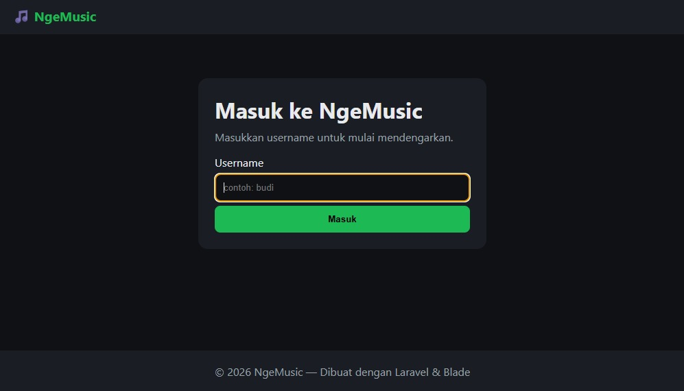
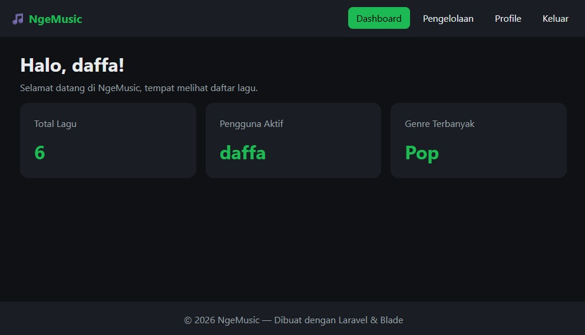
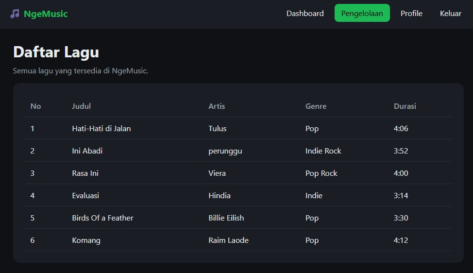
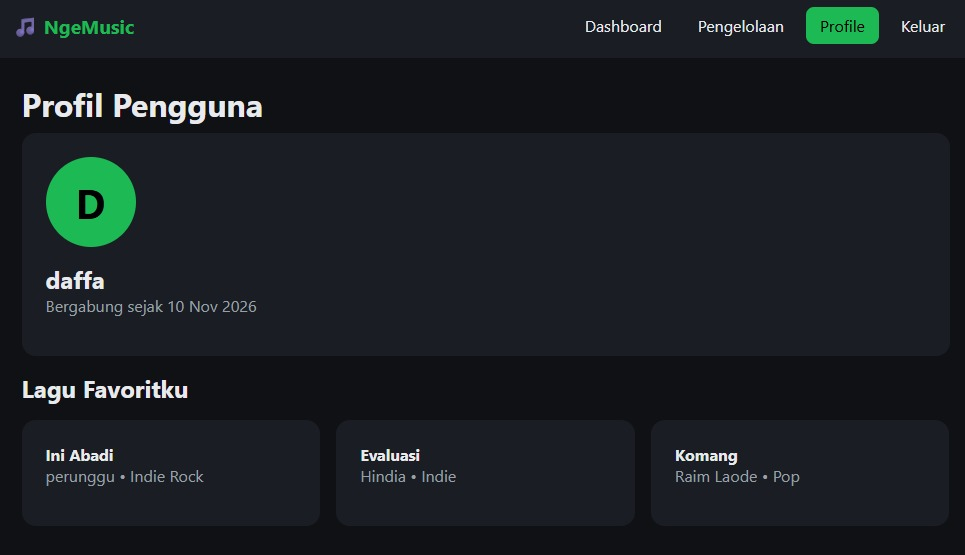

# NgeMusic
Web berbasis **Laravel** untuk mengelola dan menampilkan katalog musik. Di sini juga menampilkan total lagu, pengguna aktif, genre terbanyak, serta data lagu dan profil pengguna.

## Tampilan Aplikasi

### Login

### Dashboard

### Pengelolaan

### Profil

- **Autentikasi Pengguna**: Akses masuk (Login) sistem untuk pengguna.
- **Dashboard **: total lagu, pengguna aktif, dan genre lagu terbanyak.
- **Pengelolaan Data Musik**: Fitur katalog lagu.
- **Manajemen Profil**: Halaman untuk melihat informasi akun dan melihatv lagu favoritnya.
